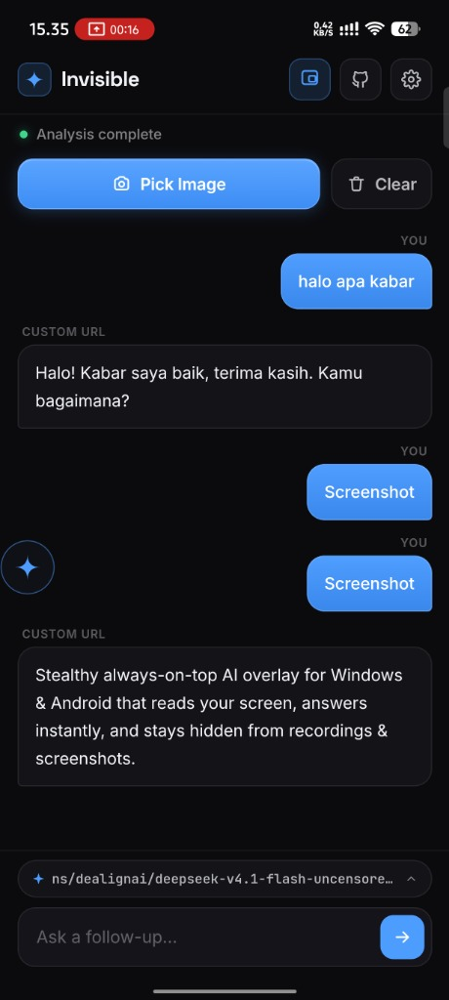
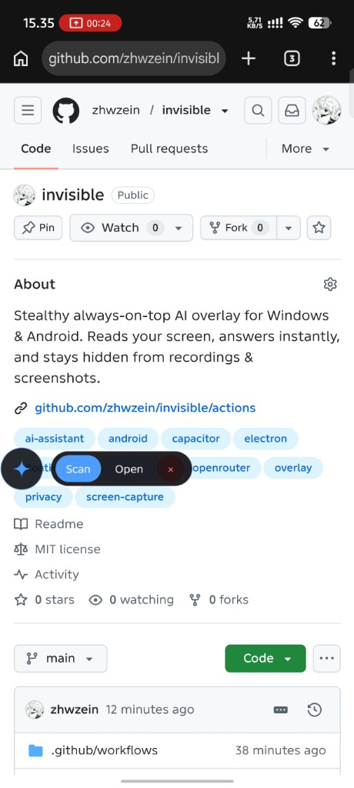

<div align="center">

# ✦ Invisible

**The open-source AI overlay that sees your screen — while staying completely invisible to screenshots & screen recordings.**

[](LICENSE)
[](https://github.com/zhwzein/invisible/actions/workflows/android-apk.yml)
[](https://github.com/zhwzein/invisible/releases/latest)
[](#quick-start)

[Download Latest Android APK](https://github.com/zhwzein/invisible/releases/latest) · [Features](#features) · [Quick Start](#quick-start) · [Shortcuts](#desktop-shortcuts)

</div>

---

## Preview

<div align="center">

| Desktop (Windows) | Android App | Android Floating Overlay |
| :---: | :---: | :---: |
|  |  |  |

</div>

---

## Features

- **Invisible to Screen Capture** — Excludes itself from screenshots, screen sharing, and recordings using `SetWindowDisplayAffinity` (`WDA_EXCLUDEFROMCAPTURE`) on Windows and `FLAG_SECURE` on Android.
- **Android Floating Bubble + Live Mini-Answer Popup** — Float a draggable bubble over any app (`SYSTEM_ALERT_WINDOW`), tap **Scan** to capture the screen (`MediaProjection`), and read streaming answers directly in a floating popup without leaving your app.
- **Real-Time SSE Streaming & Stop Control** — Answers stream token-by-token with a one-tap **Stop** button to cancel slow responses anytime.
- **Region / Area Crop Capture** — Drag to select only the exact part of the screen you want analyzed instead of sending the whole display.
- **Any AI Provider + Live `/models` Picker** — Works with **Google Gemini**, **OpenRouter**, and any **Custom OpenAI-compatible endpoint** (Ollama, LM Studio, vLLM, or hosted proxies) with live model switching right from the composer.
- **Local Multi-Session Chat History** — Conversations are saved locally in `localStorage` so you can switch back to any previous chat and continue seamlessly.
- **Voice Input & Quick Prompt Presets** — Dictate questions hands-free via Web Speech API or fire one-tap chips (`Solve`, `Explain`, `Translate ID`, `Fix Code`, `Ringkas`).
- **Custom System Prompt & Local Knowledge Folder** — Tailor AI behavior with custom instructions, and on desktop, index local PDFs, text files, and images so answers reference your own documents.
- **Markdown Code Copy & Full-Size Image Lightbox** — One-click copy on every code block and AI reply, plus click-to-zoom preview and full-size download for markdown images.

---

## Quick Start

### Android (Easiest)

1. Download the latest APK from [**GitHub Releases**](https://github.com/zhwzein/invisible/releases/latest).
2. Install the APK, open **Settings**, and add your Gemini, OpenRouter, or Custom URL API key.
3. Tap the **Float** icon in the header to scan any app on your screen.

### Desktop (Windows)

Requires **Node.js 22+**.

```bash
git clone https://github.com/zhwzein/invisible.git
cd invisible
npm install
npm start
```

> **Tip:** On Windows, you can double-click `start.bat` to auto-install missing dependencies and launch Invisible immediately.

For development with DevTools:

```bash
npm run dev
```

### Build Android APK from Source

Requires **Node.js 22**, **Java 21 (Temurin)**, and Android SDK.

```bash
npm run android:sync
cd android
./gradlew assembleDebug
```

The APK is generated at `android/app/build/outputs/apk/debug/app-debug.apk`. Every push to `main` also builds and publishes a ready-to-install APK automatically via [.github/workflows/android-apk.yml](.github/workflows/android-apk.yml).

---

## Desktop Shortcuts

| Shortcut | Action |
| :--- | :--- |
| `Alt + C` | Capture screen & analyze immediately |
| `Alt + S` | Show / hide the overlay |
| `Alt + I` | Focus the follow-up input box |
| `Alt + T` | Cycle window transparency |
| `Alt + Q` | Quit Invisible |

---

## Configuration

Settings are stored locally (`config.json` in Electron `userData` on desktop, `localStorage` on Android) — no account or cloud backend required.

- **Gemini:** API key & model (default `gemini-2.0-flash`)
- **OpenRouter:** API key & model (default `openai/gpt-4o`)
- **Custom URL:** Any OpenAI-compatible base or `/chat/completions` URL, optional key & auto-detected model
- **Custom System Prompt & User Context:** Persisted instructions sent with every request
- **Knowledge Folder (Desktop):** Local folder of PDFs, text files, and images attached automatically

---

## License

MIT License — see [LICENSE](LICENSE). Created by [Zen (zhwzein)](https://github.com/zhwzein/invisible).

If Invisible helps you, consider giving it a **Star** ⭐ on GitHub!
