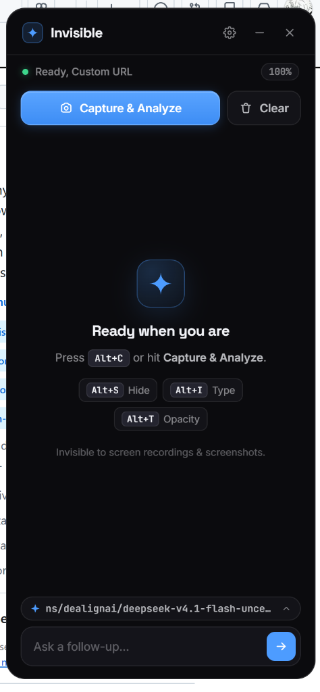

# Invisible

[](LICENSE)
[](https://github.com/zhwzein/invisible/actions/workflows/android-apk.yml)

Invisible is an always-on-top AI overlay for desktop (Electron) and Android (Capacitor) that reads your screen and answers questions while staying hidden from screenshots and screen recordings. It supports Gemini, OpenRouter, and custom OpenAI-compatible endpoints, with local knowledge-folder indexing on desktop and a floating screen-scan bubble on Android.

## Screenshots

| Desktop (Windows) | Android App | Android Floating Overlay |
| :---: | :---: | :---: |
|  |  |  |

## Requirements

- **Desktop:** Node.js (CI uses Node.js 22) and Windows (uses `SetWindowDisplayAffinity` via `user32.dll` for capture exclusion, with Electron `setContentProtection` as fallback).
- **Android build:** Node.js 22, Java 21 (Temurin), and the Android SDK / Gradle wrapper (`android/gradlew`).

## Installation

Clone the repository and install dependencies:

```bash
git clone https://github.com/zhwzein/invisible.git
cd invisible
npm install
```

On Windows, you can also run `start.bat`, which installs missing modules and launches the desktop app.

## Configuration

Settings are stored locally in `config.json` inside Electron's `userData` directory on desktop, and in `localStorage` (`invisible_config_v1`) on Android. Open **Settings** inside the app to configure a provider before your first capture:

- **Gemini:** API key (`geminiKey`) and model (`geminiModel`, default `gemini-2.0-flash`).
- **OpenRouter:** API key (`openrouterKey`) and model (`openrouterModel`, default `openai/gpt-4o`).
- **Custom URL:** Base or `chat/completions` endpoint (`customUrl`), optional API key (`customKey`), and optional model (`customModel`).
- **User context (optional):** Short profile (`userContext`) sent with each request.
- **Knowledge folder (desktop, optional):** Folder containing PDFs, text files, or images indexed locally and attached to answers. Defaults to the bundled `knowledge/` directory when present.

## Quick start

### Desktop

```bash
npm start
```

For development with DevTools:

```bash
npm run dev
```

Once running, configure a provider in **Settings**, then press `Alt+C` or click **Capture & Analyze** to capture the screen and send it to the active model. Use the bottom input bar for follow-up questions.

### Android

Build the web bundle and sync the Capacitor Android project:

```bash
npm run android:sync
```

Open the Android project in Android Studio, or build a debug APK directly with Gradle:

```bash
cd android
./gradlew assembleDebug
```

The debug APK is written to `android/app/build/outputs/apk/debug/app-debug.apk`. Pushing to `main` or `master` also builds and uploads `invisible-android-apk` via [.github/workflows/android-apk.yml](.github/workflows/android-apk.yml).

## What it does

- **Capture invisibility:** Excludes the overlay window from screenshots and screen recordings on Windows (`WDA_EXCLUDEFROMCAPTURE`) and Android (`FLAG_SECURE`).
- **Multi-provider AI & model picker:** Switch between Gemini, OpenRouter, and custom OpenAI-compatible endpoints, with `/models` lookup from the composer bar.
- **Desktop global shortcuts:** `Alt+S` (show/hide), `Alt+C` (capture & analyze), `Alt+I` (focus input), `Alt+T` (cycle transparency), `Alt+Q` (quit).
- **Local knowledge folder (desktop):** Indexes local PDFs (`pdfjs-dist`), text files, and images so answers can reference your files.
- **Floating overlay (Android):** Tap **Float** to display a draggable bubble over other apps (`SYSTEM_ALERT_WINDOW`) and capture the active screen underneath (`MediaProjection`) for analysis.

## Credits

Created by [Zen (zhwzein)](https://github.com/zhwzein/invisible).

## License

MIT License. See [LICENSE](LICENSE).
